# 01 — Sequence Diagrams (สถานะปัจจุบัน)

> แสดงสิ่งที่ระบบทำจริง ณ 2 พ.ย. 2026 บน branch `phase0-cleanup` (UI ลูกค้า 31 ต.ค.)  
> ฉบับเดิม (ต.ค.) เป็นแผน "Phase B" ที่ server คุม Stock เอง ดูได้จาก git: `git show 58c88c8:docs/01-sequence-diagrams.md`  
> ส่วนที่ยังไม่ได้ทำดูที่[ข้อ 15](#15-ยังไม่มีในระบบ)

## หลักที่ต้องรู้ก่อนอ่าน

ข้อมูลธุรกิจส่วนใหญ่ยัง**คำนวณที่หน้าจอ** แล้วซิงก์ทั้ง key ผ่าน server · มีเฉพาะงานขาย (BD02) ที่เก็บแยกเป็นตาราง

| ข้อมูล | เก็บที่ | ใครตรวจกติกา |
|---|---|---|
| Stock, RO, ใบโอน, คิวขนส่ง, RA / RMA, คิว QA, PL Queue | `kv_store` หนึ่งแถวต่อ key | หน้าจอ |
| ออเดอร์ SBO, คิวส่ง WH13, ผลตอบกลับ, ใบเสนอราคา | `sbo_order`, `sbo_handoff`, `sbo_decision`, `quotation` | server |
| ผู้ใช้, สิทธิ์, session | `app_user`, `user_access`, `auth_session` | server |
| ผลชั่ง V4 (สำเนาเพื่อค้นหา), Override, ข้อความ Bus, Audit | `weighing_*`, `override_log`, `bus_message`, `audit_log` | server บันทึกอย่างเดียว |

## Participants

| ชื่อใน diagram | คือ |
|---|---|
| `V4` `WH13` `LG02` `BD02` `QA` `PLN` | หน้าจอลูกค้า + `whrm-bridge.js` (QA = QAincoming03, PLN = Production planning301) |
| `Bridge` | `whrm-bridge.js` ในหน้าจอ: ดักการเขียน localStorage และ BroadcastChannel |
| `API` | REST `/api/v1` (Fastify) |
| `Bus` | WebSocket `/bus` ส่งต่อข้อความข้ามเครื่อง และเก็บลง `bus_message` |
| `DB` | PostgreSQL |

## สารบัญ

1. [ภาพรวมการไหลของข้อมูล](#1-ภาพรวมการไหลของข้อมูล)
2. [Login และเปิดหน้าจอ](#2-login-และเปิดหน้าจอ)
3. [ซิงก์ KV และเมื่อสองเครื่องแก้พร้อมกัน](#3-ซิงก์-kv-และเมื่อสองเครื่องแก้พร้อมกัน)
4. [ยืนยันตัวตนในหน้าจอและตรวจสิทธิ์](#4-ยืนยันตัวตนในหน้าจอและตรวจสิทธิ์)
5. [ชั่งน้ำหนัก V4 → WH13](#5-ชั่งน้ำหนัก-v4--wh13)
6. [รับเข้า RO + QA](#6-รับเข้า-ro--qa)
7. [โอนย้าย: สแกนรับที่ปลายทาง](#7-โอนย้าย-สแกนรับที่ปลายทาง)
8. [โอนย้ายผ่าน LG02 (Transfer to Logistic)](#8-โอนย้ายผ่าน-lg02-transfer-to-logistic)
9. [ชั่ง FGT ผ่าน V4](#9-ชั่ง-fgt-ผ่าน-v4)
10. [ออเดอร์ BD02 → WH13 → BD02](#10-ออเดอร์-bd02--wh13--bd02)
11. [ใบเสนอราคาและสิทธิ์](#11-ใบเสนอราคาและสิทธิ์)
12. [จ่ายของ (Dispatch)](#12-จ่ายของ-dispatch)
13. [คืนสินค้า RU → RMA และยกเลิก RU](#13-คืนสินค้า-ru--rma-และยกเลิก-ru)
14. [เน็ตหลุดและกลับมา](#14-เน็ตหลุดและกลับมา)
15. [ยังไม่มีในระบบ](#15-ยังไม่มีในระบบ)

---

## 1. ภาพรวมการไหลของข้อมูล

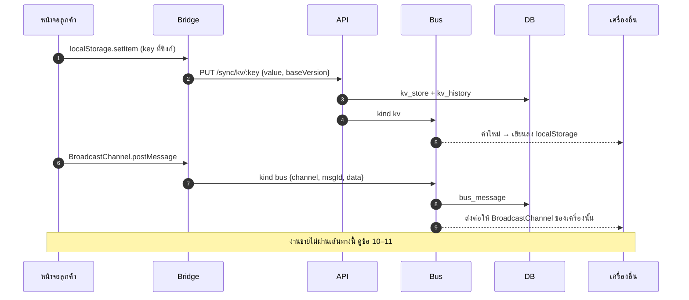

---

## 2. Login และเปิดหน้าจอ

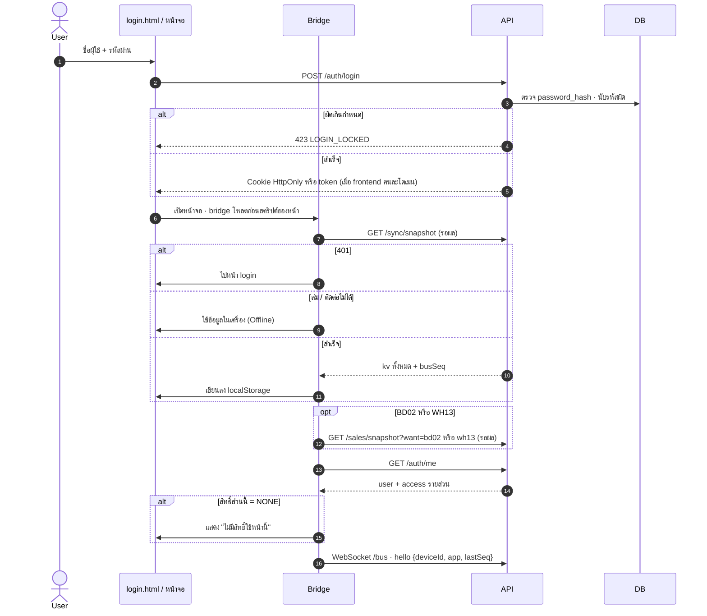

---

## 3. ซิงก์ KV และเมื่อสองเครื่องแก้พร้อมกัน

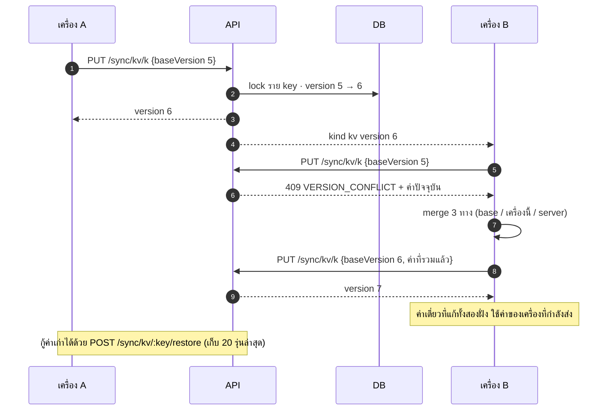

---

## 4. ยืนยันตัวตนในหน้าจอและตรวจสิทธิ์

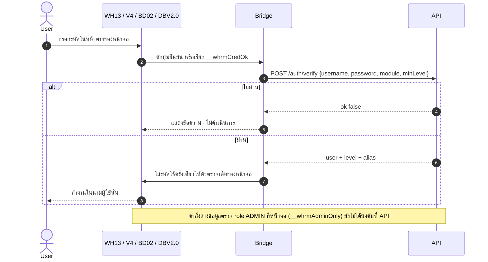

---

## 5. ชั่งน้ำหนัก V4 → WH13

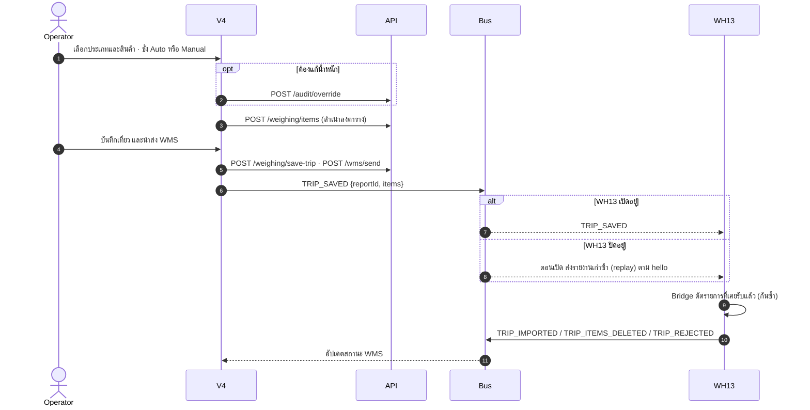

---

## 6. รับเข้า RO + QA

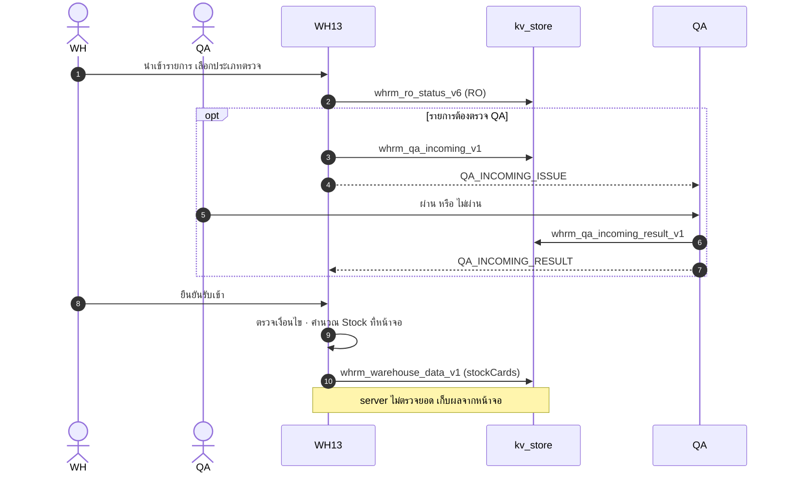

---

## 7. โอนย้าย: สแกนรับที่ปลายทาง

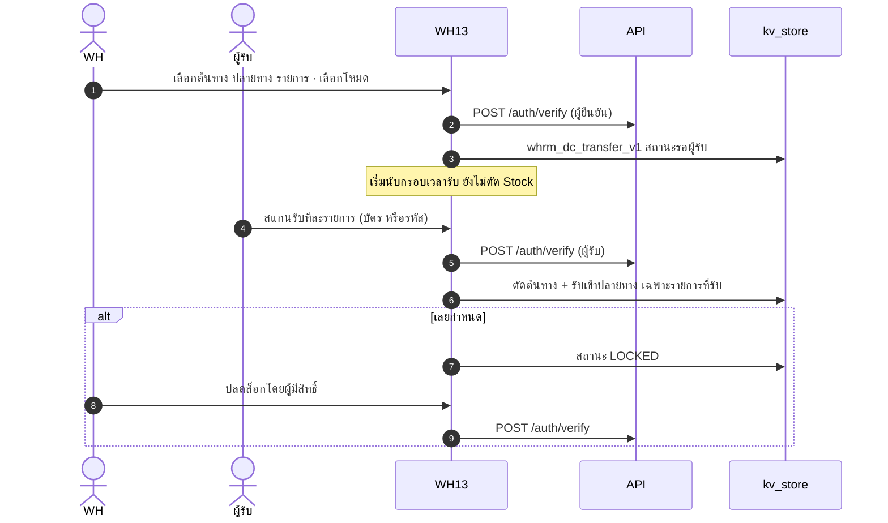

---

## 8. โอนย้ายผ่าน LG02 (Transfer to Logistic)

ทดสอบกดจริงแล้ว · ตัด Stock เมื่อรับปลายทาง ตามคำตอบลูกค้า 2 พ.ย. ([12-customer-decisions.md](12-customer-decisions.md) ข้อ 4)

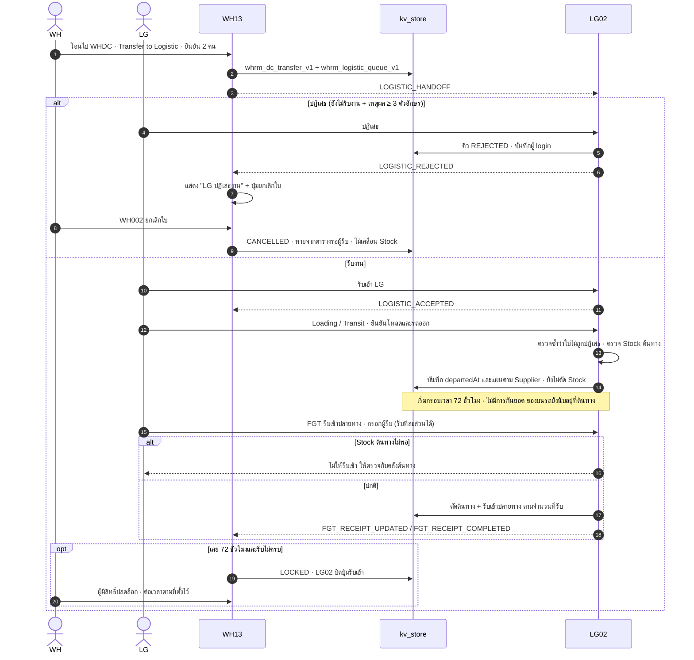

---

## 9. ชั่ง FGT ผ่าน V4

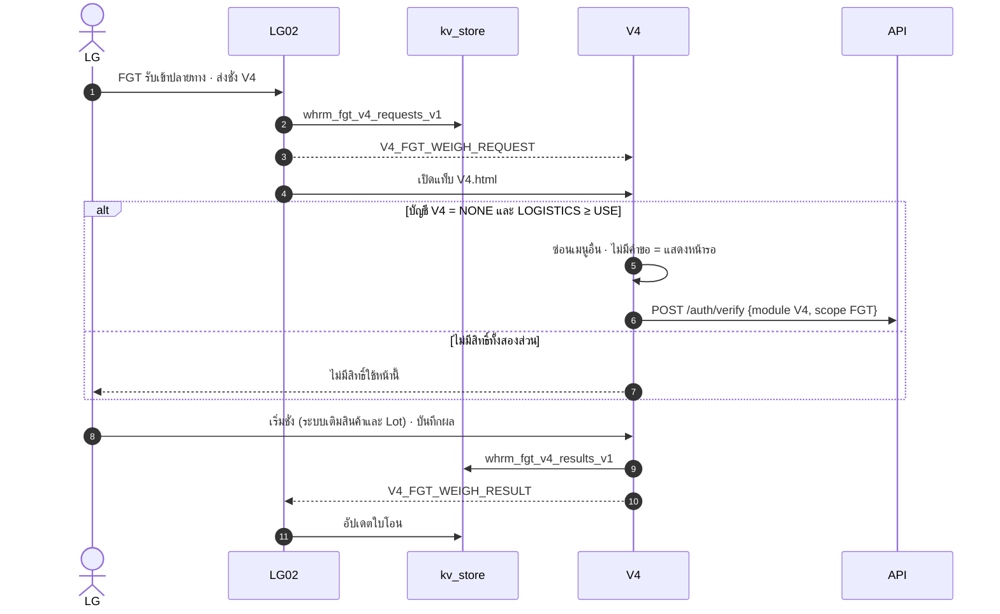

---

## 10. ออเดอร์ BD02 → WH13 → BD02

ทดสอบกดจริง: สร้างออเดอร์, ยกเลิก, Accept to WH, Need to PLN และ PLN ตอบรับ  
ขั้นตอนใน Dispatch: กดจริงไม่ครบ ผลการจ่ายทดสอบโดยตั้งสถานะ IO เป็น COMPLETE โดยตรง

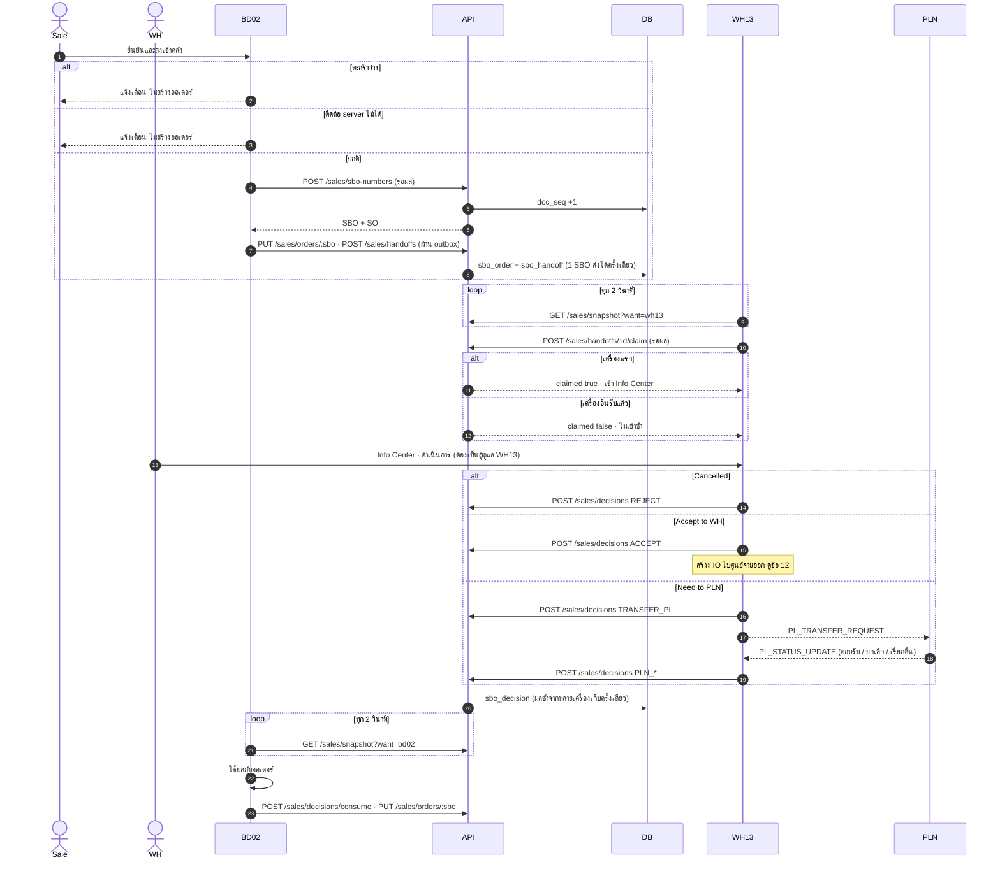

---

## 11. ใบเสนอราคาและสิทธิ์

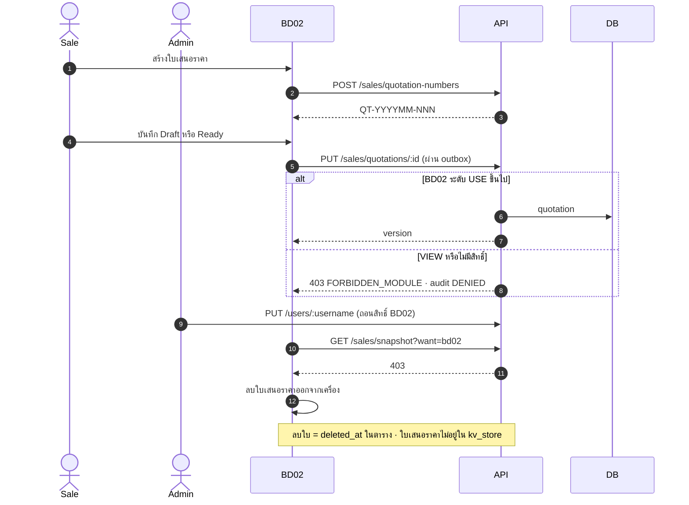

---

## 12. จ่ายของ (Dispatch)

อ่านจากโค้ด: ขั้นตรวจ, ชั่ง และ AI ยังไม่ได้กดทดสอบครบ

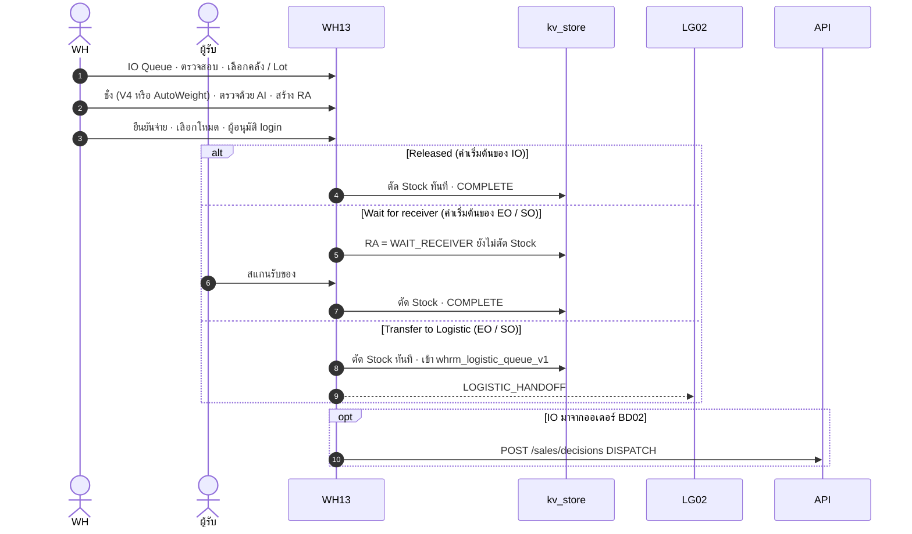

หมายเหตุ: โหมด Transfer to Logistic ของ **Dispatch ตัด Stock ทันที** แต่ของ**ใบโอน (ข้อ 8) ตัดเมื่อรับปลายทาง** ลูกค้ายืนยันว่าตั้งใจให้ต่างกัน

---

## 13. คืนสินค้า RU → RMA และยกเลิก RU

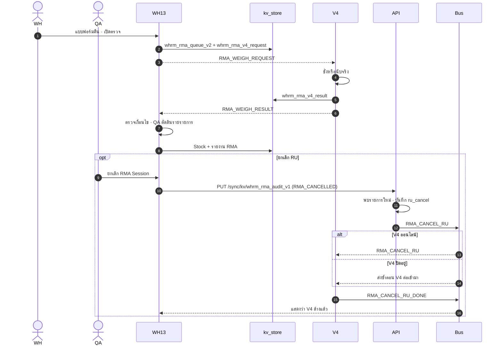

---

## 14. เน็ตหลุดและกลับมา

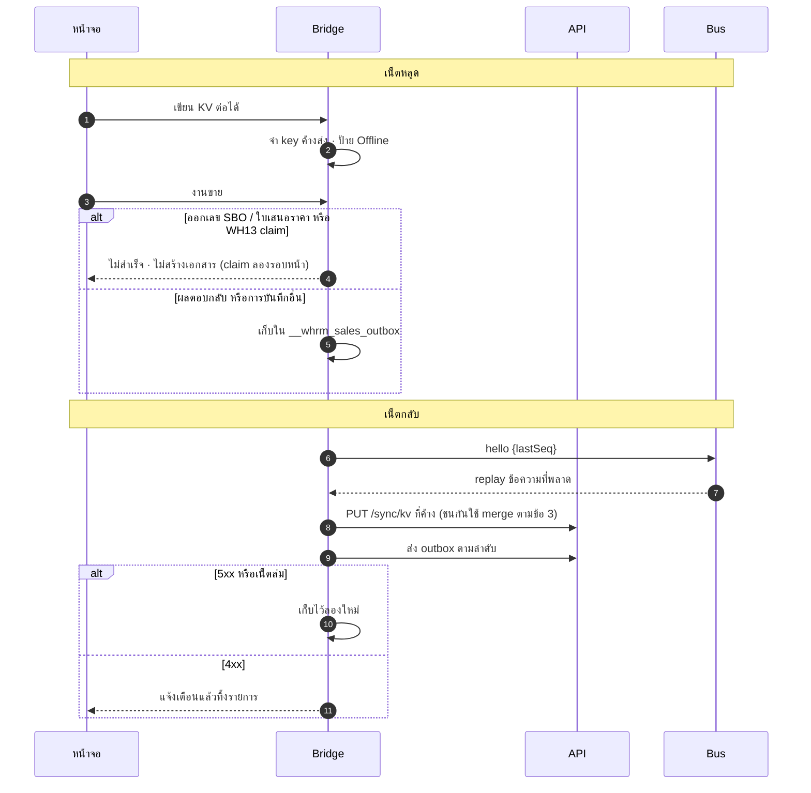

---

## 15. ยังไม่มีในระบบ

| เรื่อง | สถานะจริง | แผนงาน |
|---|---|---|
| `/receiving/*`, `/inventory/*`, `/requisitions`, `/approvals`, `/qa/*`, `/returns/*`, `/prp/*`, `/print/jobs`, `/doc-sequences` | ไม่มี API เหล่านี้ งานทำที่หน้าจอ + `kv_store` | ทยอยตามเฟสย้ายระบบ |
| Server คุมยอด Stock (`stock_movement`, `stock_balance`, FEFO, HOLD) | ไม่มี | เฟส 2–3 |
| ใบโอนและคิวขนส่งในตาราง | อยู่ใน `kv_store` | เฟส 1 |
| กันการลบ `kv_store` ตามสิทธิ์ | ผู้ที่ login เขียนหรือลบได้ทุก key ที่อนุญาต | ควรทำก่อนใช้จริง |
| Agent เครื่องชั่ง / เครื่องพิมพ์ฝั่ง server | ไม่มี | ยังไม่กำหนด |
| PRP และคำขอปลดล็อก | ทำงานที่หน้าจอ ไม่มี API เฉพาะ จึงไม่ได้วาดแยก | ทยอยตามเฟส |
