# 01 — Sequence Diagrams (Overview)

> ประกอบ [BACKEND-DESIGN.md](../BACKEND-DESIGN.md) · UI = V4.html / WH13.html (ไม่เปลี่ยนหน้าจอ) · Backend = WH-RM API
> ทุก diagram แสดงสถานะ **Phase B** (server เป็น source of truth) — จุดที่ต่างใน Phase A มีหมายเหตุกำกับ

## Participants

| ชื่อใน diagram | คือ |
|---|---|
| `Operator` / `WH` / `QA` / `Sup` | ผู้ใช้: พนักงานชั่ง / พนักงานคลัง / QA / หัวหน้างาน |
| `V4` | V4.html + whrm-bridge.js (สถานีชั่ง) |
| `WH13` | WH13.html + whrm-bridge.js (WMS + QA Gate) |
| `API` | REST `/api/v1` |
| `Bus` | WebSocket gateway `/bus` (relay message แบบ envelope เดิมของ WHBus) |
| `DB` | PostgreSQL |
| `Agent` | Scale/Printer agent บนเครื่องสถานีชั่ง (Phase C) |

## สารบัญ

1. [ภาพรวม end-to-end](#1-ภาพรวม-end-to-end)
2. [เปิดหน้าจอ + Hydrate + Login](#2-เปิดหน้าจอ--hydrate--login)
3. [ชั่งน้ำหนักและบันทึก Trip (V4 → WH13)](#3-ชั่งน้ำหนักและบันทึก-trip-v4--wh13)
4. [Override น้ำหนัก](#4-override-น้ำหนัก)
5. [Import เป็น RO (Goods Receipt)](#5-import-เป็น-ro-goods-receipt)
6. [QA ตรวจ + Approve RO / Reject → WHSM06](#6-qa-ตรวจ--approve-ro--reject--whsm06)
7. [Stock Out / เบิก / FGT (FEFO + HOLD + ของพอ)](#7-stock-out--เบิก--fgt-fefo--hold--ของพอ)
8. [โอนย้ายระหว่างคลัง](#8-โอนย้ายระหว่างคลัง)
9. [HOLD / Release Lot](#9-hold--release-lot)
10. [คืนสินค้า RU → RMA](#10-คืนสินค้า-ru--rma)
11. [Offline / Reconnect](#11-offline--reconnect)
12. [PRP — เตรียมวัตถุดิบเข้า WHSM07](#12-prp--เตรียมวัตถุดิบเข้า-whsm07)
13. [ขอปลดล็อก PRP (GR → QA)](#13-ขอปลดล็อก-prp-gr--qa)
14. [ยกเลิก RU (WH13 → V4 → DONE)](#14-ยกเลิก-ru-wh13--v4--done)

---

## 1. ภาพรวม end-to-end

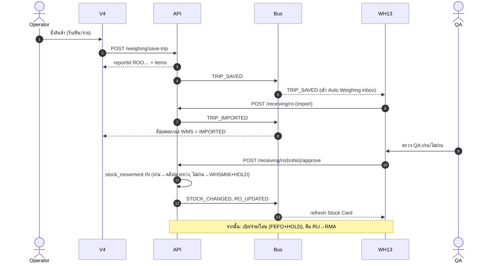

---

## 2. เปิดหน้าจอ + Hydrate + Login

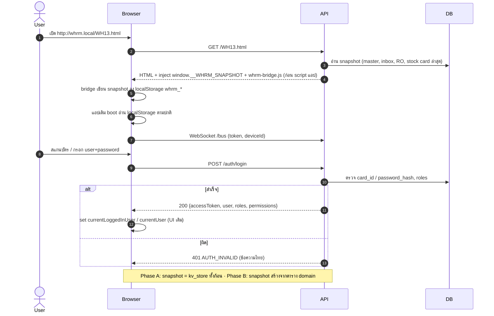

---

## 3. ชั่งน้ำหนักและบันทึก Trip (V4 → WH13)

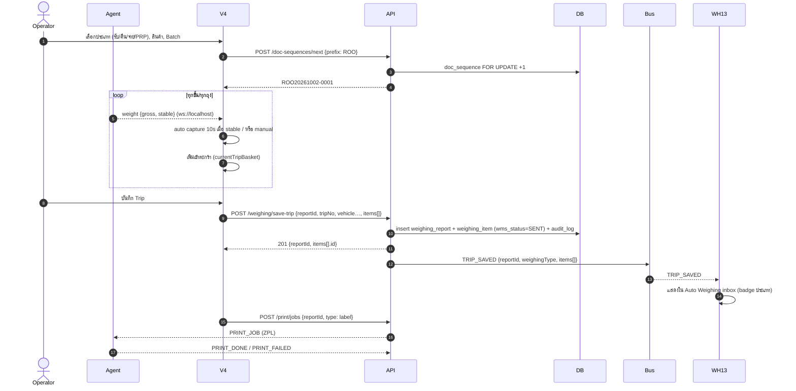

---

## 4. Override น้ำหนัก

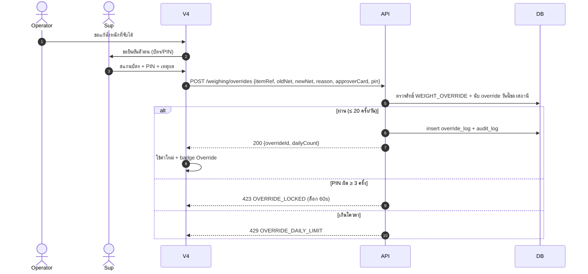

---

## 5. Import เป็น RO (Goods Receipt)

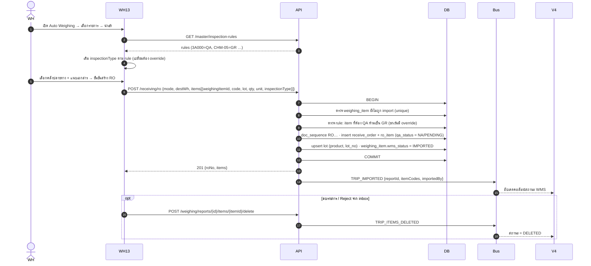

---

## 6. QA ตรวจ + Approve RO / Reject → WHSM06

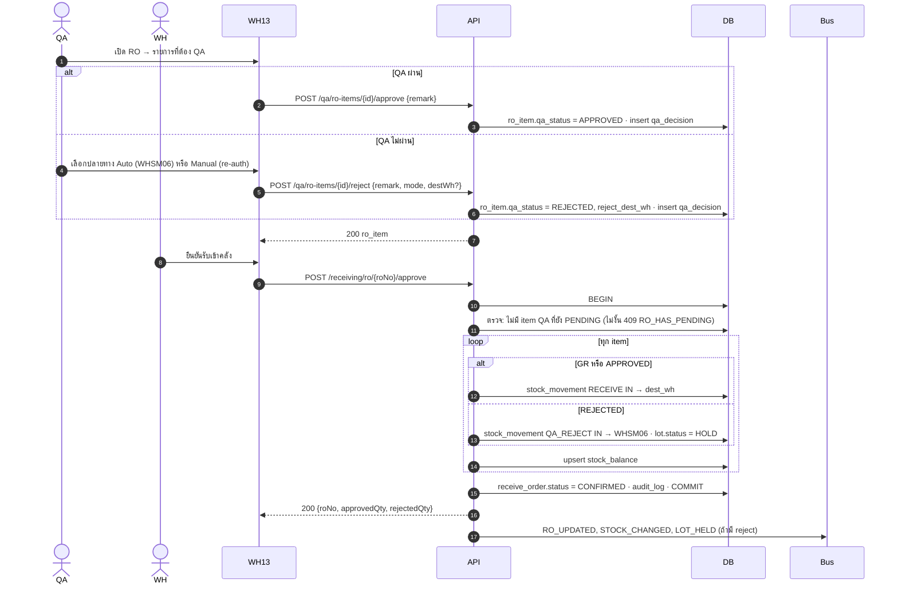

---

## 7. Stock Out / เบิก / FGT (FEFO + HOLD + ของพอ)

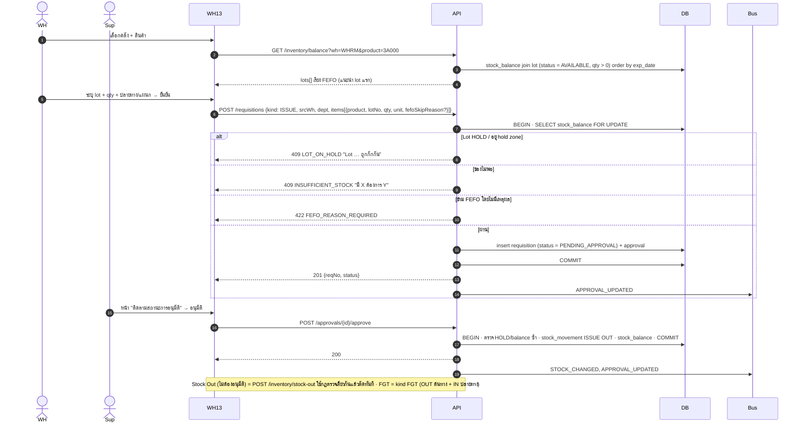

---

## 8. โอนย้ายระหว่างคลัง

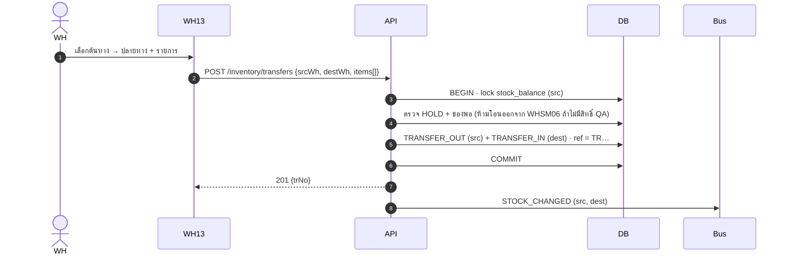

---

## 9. HOLD / Release Lot

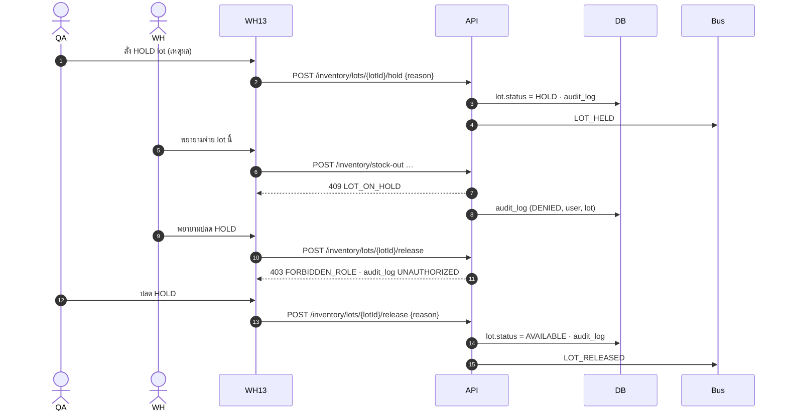

---

## 10. คืนสินค้า RU → RMA

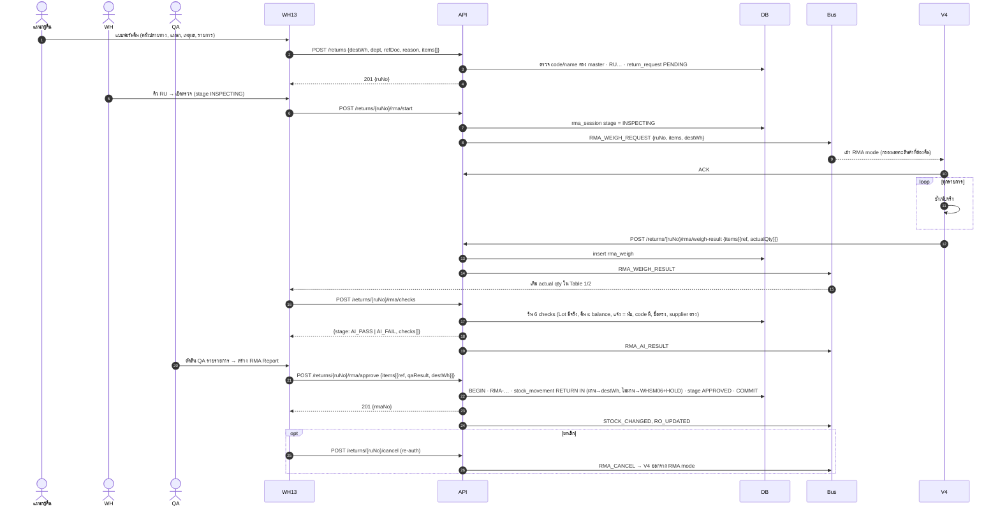

---

## 11. Offline / Reconnect

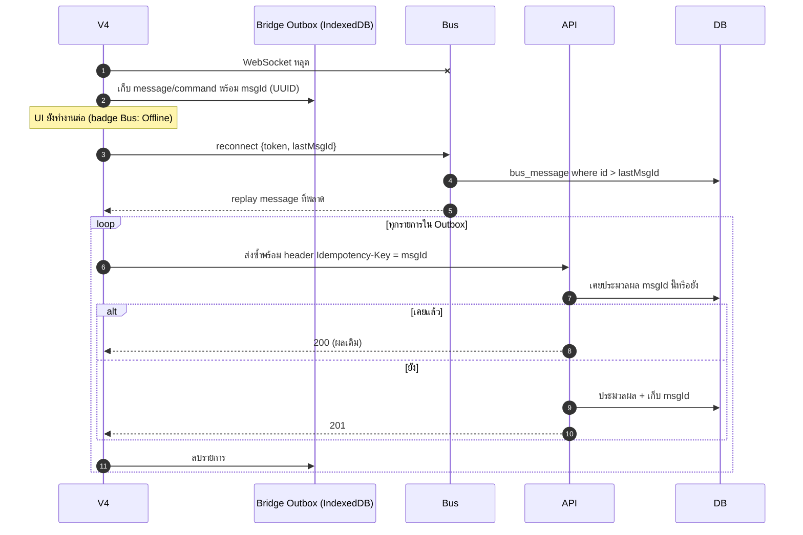

---

> **เพิ่ม 2 ต.ค. 2026** ตาม UI เวอร์ชัน `1790951454` (ดู [04-ui-v2-change-review.md](04-ui-v2-change-review.md))

## 12. PRP — เตรียมวัตถุดิบเข้า WHSM07

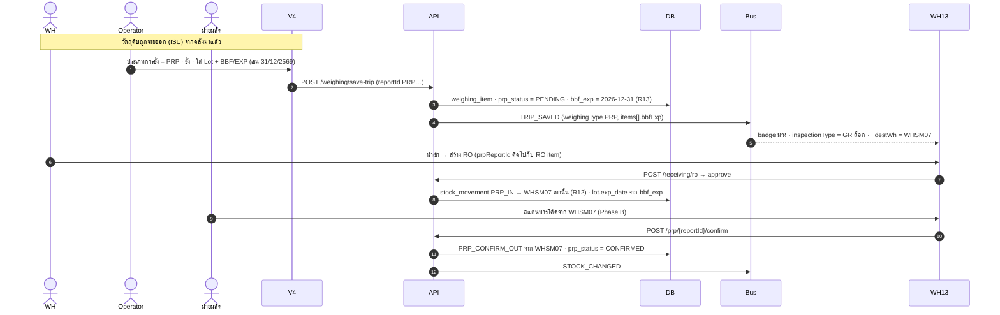

## 13. ขอปลดล็อก PRP (GR → QA)

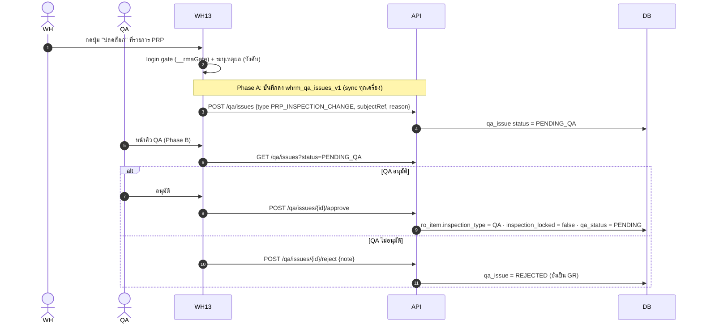

## 14. ยกเลิก RU (WH13 → V4 → DONE)

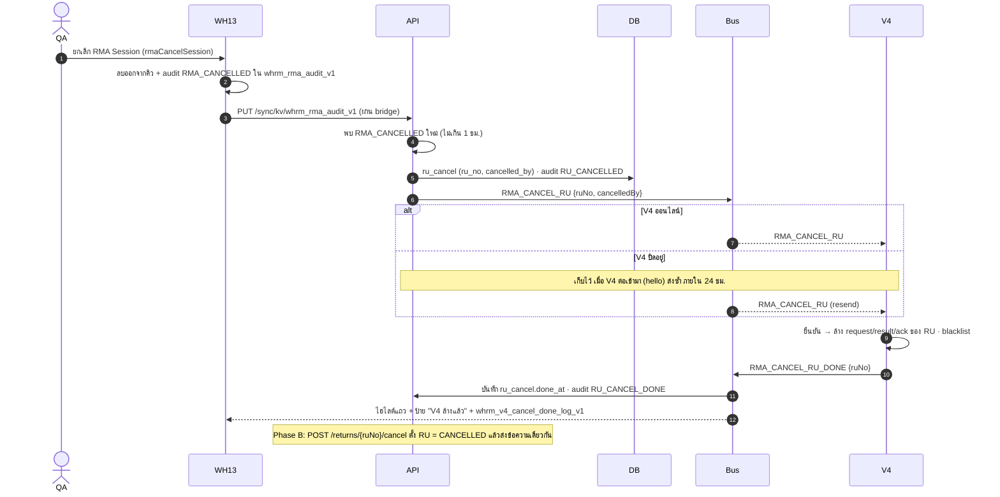
