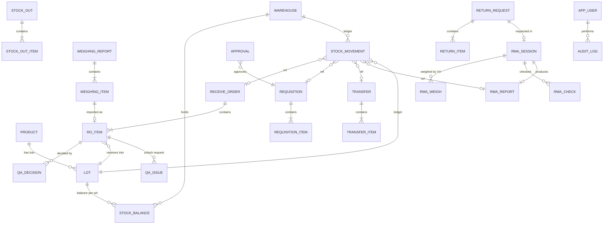
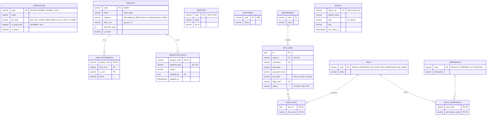
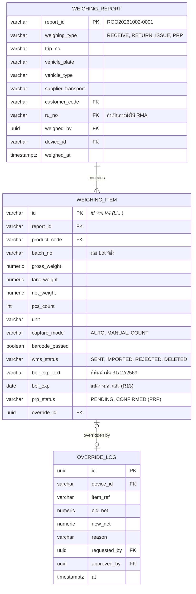
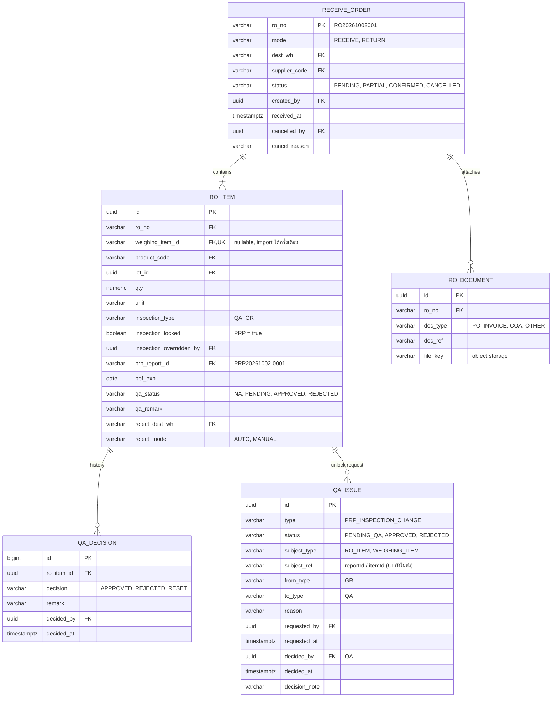
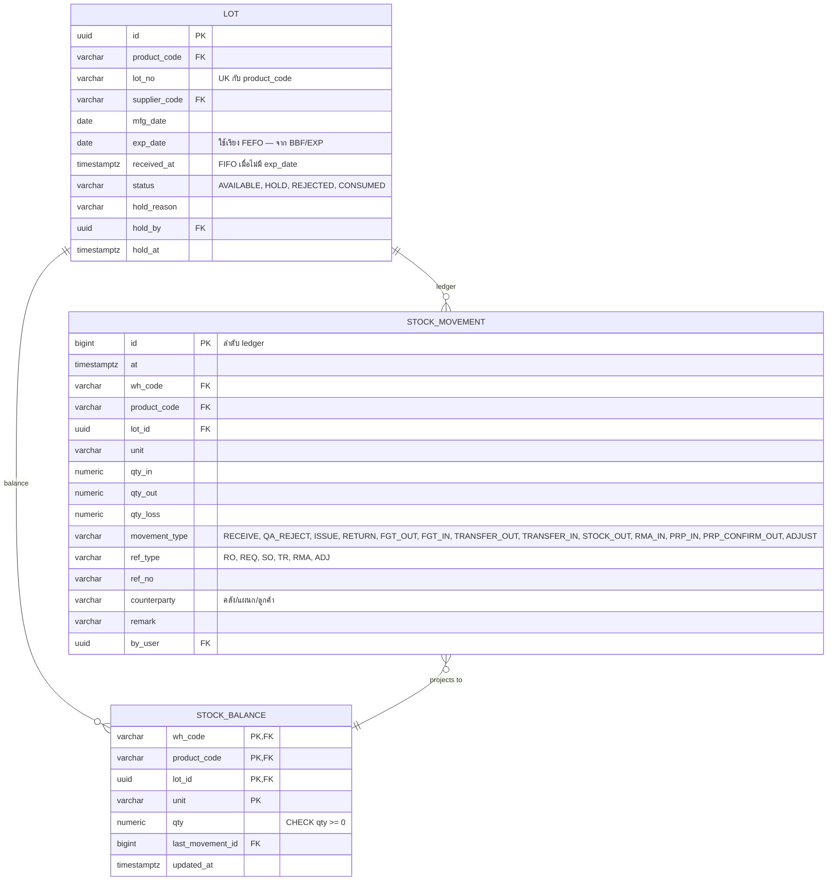
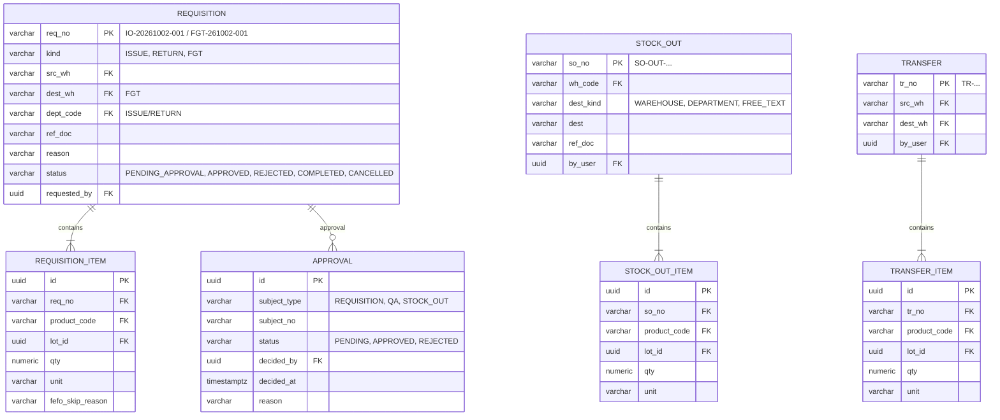
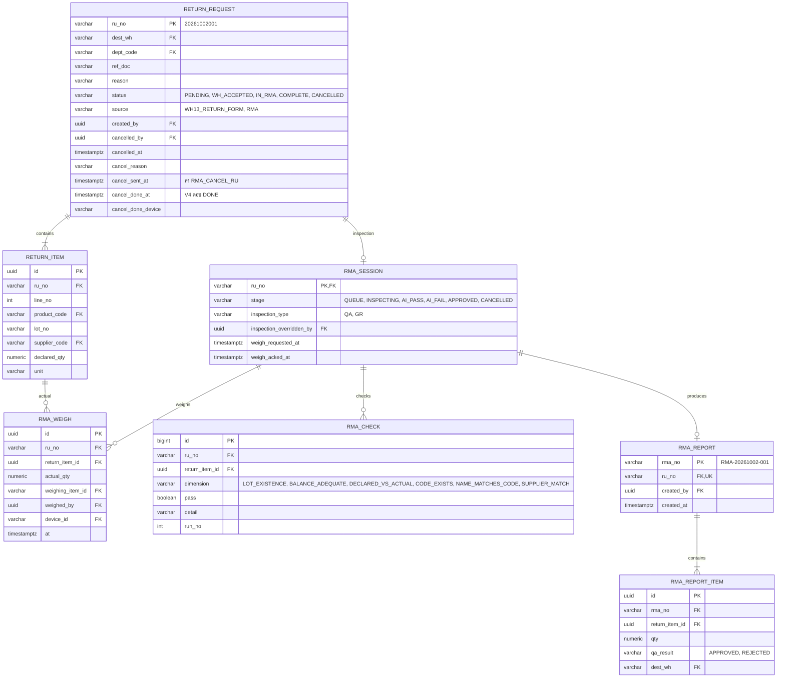

# 02 — ERD (PostgreSQL)

> ประกอบ [BACKEND-DESIGN.md](../BACKEND-DESIGN.md) §4 · ชื่อตาราง/คอลัมน์เป็น snake_case · เวลาเป็น `timestamptz`
> จำนวนเป็น `numeric(14,3)` · ทุกตารางธุรกรรมมี `created_at`, `created_by` (ละไว้ใน diagram ถ้าไม่จำเป็น)
> **อัปเดต 2 ต.ค. 2026** ตาม UI เวอร์ชัน `1790951454` — PRP, BBF/EXP, ขอปลดล็อก PRP (`qa_issue`), ยกเลิก RU · ดู [04-ui-v2-change-review.md](04-ui-v2-change-review.md) §7

## สารบัญ
1. [Overview — ความสัมพันธ์ทั้งระบบ](#1-overview)
2. [Master & Security](#2-master--security)
3. [Weighing (V4)](#3-weighing-v4)
4. [Receiving + QA](#4-receiving--qa)
5. [Inventory Ledger](#5-inventory-ledger)
6. [Requisition / Stock Out / Transfer / Approval](#6-requisition--stock-out--transfer--approval)
7. [Return (RU) / RMA](#7-return-ru--rma)
8. [System (sequence, audit, bus, sync, print)](#8-system)
9. [Enums](#9-enums)
10. [Constraints & Indexes สำคัญ](#10-constraints--indexes-สำคัญ)

---

## 1. Overview



> `stock_movement` อ้างเอกสารต้นทางแบบ polymorphic (`ref_type` + `ref_no`) — เส้น "ref" ใน diagram เป็นความสัมพันธ์เชิงตรรกะ ไม่ใช่ FK จริง

---

## 2. Master & Security



---

## 3. Weighing (V4)



---

## 4. Receiving + QA



---

## 5. Inventory Ledger



**Stock Card (ที่ UI แสดง)** = view จาก ledger:

```sql
CREATE VIEW v_stock_card AS
SELECT m.*, SUM(m.qty_in - m.qty_out - m.qty_loss)
         OVER (PARTITION BY m.wh_code, m.product_code, m.lot_id, m.unit ORDER BY m.id) AS balance,
       l.lot_no, l.status = 'HOLD' AS hold
FROM stock_movement m JOIN lot l ON l.id = m.lot_id;
```

---

## 6. Requisition / Stock Out / Transfer / Approval



---

## 7. Return (RU) / RMA



---

## 8. System

```mermaid
erDiagram
    DOC_SEQUENCE {
        varchar prefix PK "ROO, REE, ISU, PRP, RO, RU, IO, FGT, RMA, TR, SO"
        varchar period PK "YYYYMMDD"
        int last_no
    }
    AUDIT_LOG {
        bigint id PK
        timestamptz at
        uuid user_id FK
        varchar device_id FK
        uuid request_id
        varchar action "RO_APPROVE, LOT_RELEASE, DENIED ..."
        varchar result "OK, DENIED, ERROR"
        varchar entity_type
        varchar entity_id
        jsonb before
        jsonb after
    }
    BUS_MESSAGE {
        bigint id PK "ใช้ replay"
        uuid msg_id UK "idempotency"
        varchar type "TRIP_SAVED ..."
        varchar source "V4, WH13, SERVER"
        varchar device_id FK
        jsonb payload
        timestamptz at
    }
    IDEMPOTENCY_KEY {
        uuid key PK
        varchar endpoint
        int status_code
        jsonb response
        timestamptz at
    }
    KV_STORE {
        varchar key PK "whrm_* (Phase A)"
        jsonb value
        int version "optimistic lock"
        uuid updated_by FK
        varchar device_id FK
        timestamptz updated_at
    }
    RU_CANCEL {
        varchar ru_no PK "Phase A — ใช้ไปก่อนจนมี return_request"
        varchar cancelled_by
        timestamptz cancelled_at
        varchar source_device
        timestamptz sent_at
        int send_count
        timestamptz done_at
        varchar done_device
    }
    PRINT_JOB {
        uuid id PK
        varchar report_id FK
        varchar job_type "LABEL, REPORT"
        varchar device_id FK
        jsonb payload
        varchar status "QUEUED, SENT, DONE, FAILED"
        int attempts
        varchar error
    }
```



---

## 9. Enums

| Enum | ค่า |
|---|---|
| `weighing_type` | RECEIVE (รับ/ROO), RETURN (คืน/REE), ISSUE (จ่าย/ISU), PRP |
| `wms_status` | SENT, IMPORTED, REJECTED, DELETED |
| `inspection_type` | QA, GR |
| `qa_status` | NA, PENDING, APPROVED, REJECTED |
| `ro_status` | PENDING, PARTIAL, CONFIRMED, CANCELLED |
| `lot_status` | AVAILABLE, HOLD, REJECTED, CONSUMED |
| `movement_type` | RECEIVE, QA_REJECT, ISSUE, RETURN, FGT_OUT, FGT_IN, TRANSFER_OUT, TRANSFER_IN, STOCK_OUT, RMA_IN, PRP_IN, PRP_CONFIRM_OUT, ADJUST |
| `requisition_kind` | ISSUE, RETURN, FGT |
| `ru_status` | PENDING, WH_ACCEPTED, IN_RMA, COMPLETE, CANCELLED |
| `rma_stage` | QUEUE, INSPECTING, AI_PASS, AI_FAIL, APPROVED, CANCELLED |
| `prp_status` | PENDING (อยู่ WHSM07 รอฝ่ายผลิต), CONFIRMED (ฝ่ายผลิตสแกนรับ → OUT WHSM07) |
| `qa_issue_status` | PENDING_QA, APPROVED, REJECTED |

## 10. Constraints & Indexes สำคัญ

| ตาราง | Constraint / Index | เหตุผล |
|---|---|---|
| `lot` | `UNIQUE (product_code, lot_no)` | Lot เดียวกันของสินค้าเดียวกันต้องเป็นแถวเดียว |
| `ro_item` | `UNIQUE (weighing_item_id) WHERE weighing_item_id IS NOT NULL` | import รายการชั่งได้ครั้งเดียว (R8) |
| `stock_balance` | `CHECK (qty >= 0)` | ห้ามติดลบ (R2) — กันชั้นสุดท้ายถึงแม้ service พลาด |
| `stock_movement` | `INDEX (wh_code, product_code, lot_id, id)` | Stock Card + running balance |
| `stock_movement` | `INDEX (ref_type, ref_no)` | trace จากเอกสาร |
| `lot` | `INDEX (product_code, exp_date NULLS LAST, received_at) WHERE status = 'AVAILABLE'` | FEFO — Lot ไม่มีวันหมดอายุต่อท้ายแบบ FIFO (R7) |
| `ro_item` | `CHECK (NOT inspection_locked OR inspection_type = 'GR')` เว้นแต่มี qa_issue APPROVED | PRP ล็อก GR (R12) |
| `audit_log`, `stock_movement`, `qa_decision`, `bus_message` | `REVOKE UPDATE, DELETE` จาก app role | append-only (immutable) |
| `audit_log` | `INDEX (at DESC)`, `INDEX (entity_type, entity_id)` | query 30 วัน < 3s |
| `bus_message` | `UNIQUE (msg_id)` | dedupe ตอน reconnect |
| `doc_sequence` | อ่านด้วย `SELECT … FOR UPDATE` | เลขไม่ซ้ำเมื่อหลายเครื่อง (R10) |
